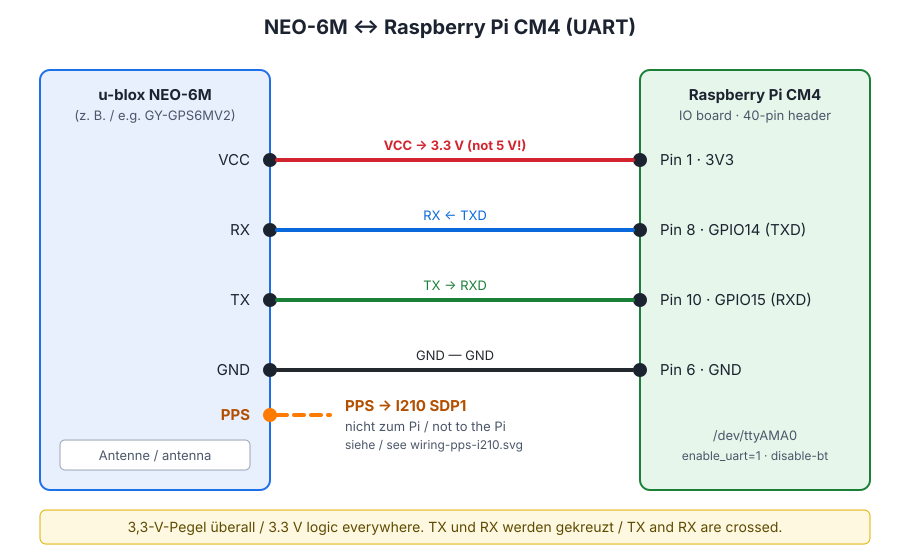
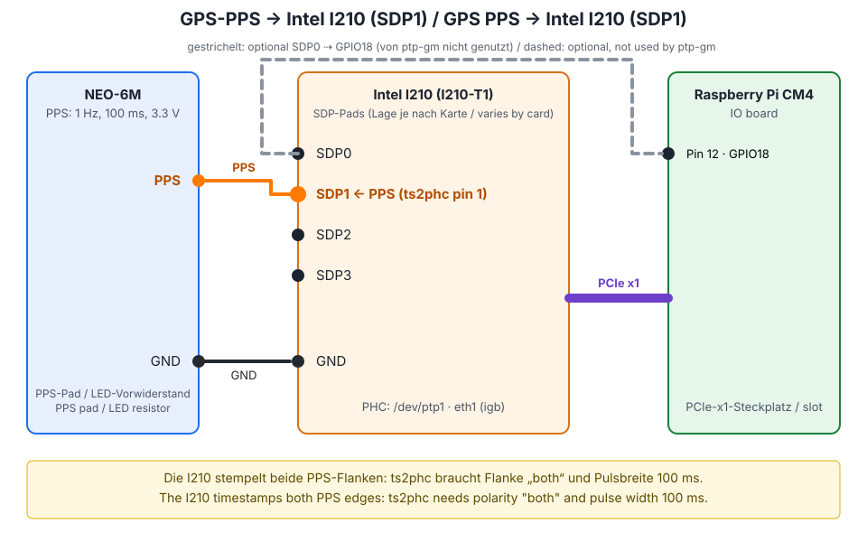

# ptp-gm – GPS-gestützte PTP Grandmaster Clock + PTP-Messgerät

🇩🇪 Deutsch · [🇬🇧 English version below](#english)

> **Status:** auf echter Hardware getestet (Raspberry Pi CM4 + Intel I210 + u-blox NEO-6M), siehe [Hardwaretest](#hardwaretest).

Raspberry Pi (CM4/Pi 4/Pi 5) mit **Intel I210** und **u-blox NEO-6M**.
Das PPS-Signal des GPS-Moduls wird direkt an die I210 geführt und dort von der
Hardware-Uhr (PHC) mit Zeitstempel versehen. Dadurch hängt die Genauigkeit nicht
an der Interrupt-Latenz des Pi.

```
NEO-6M ──NMEA (UART)──► gpsd ──► ts2phc ◄──PPS── I210 SDPx
                                     │
                                     ▼
                             I210-PHC (TAI) ──► ptp4l (Master, eth1) ──► PTP-Clients
                                     │
                                     └──► chrony (refclock PHC) ──► Systemzeit ──► NTP-Server
```

Betriebsarten (umschaltbar im Web-UI):

| Modus | Dienste | Zweck |
|---|---|---|
| **Grandmaster** | gpsd, ts2phc, ptp4l (Master), chrony (oder phc2sys) | Zeitquelle im Netz |
| **Messgerät** | gpsd, ts2phc, ptp4l (nur Client, `free_running`) | Die PHC wird per GPS-PPS geführt, `ptp4l` misst Offset und Pfadverzögerung eines fremden Grandmasters dagegen, ohne eine Uhr zu verstellen. Messgerät- und PPS-Interface müssen dieselbe Karte sein. |
| **Aus** | nichts | |

Die Weboberfläche zeigt GPS-Status, PPS→PHC-Offset, PTP-Status, Verlaufsdiagramm
mit Statistik (Mittel, σ, RMS, Min/Max), CSV-Export, Konfiguration und Logs.

## Verkabelung

**1. GPS-Modul an den Raspberry Pi CM4** (UART, 3,3 V – nicht an 5 V):



| NEO-6M | CM4 IO-Board, 40-Pin-Header |
|---|---|
| VCC | Pin 1 (3,3 V) |
| GND | Pin 6 |
| TX | Pin 10 (RXD, GPIO15) |
| RX | Pin 8 (TXD, GPIO14) |
| **PPS** | **nicht an den Pi, sondern an die I210 (siehe unten)** |

**2. PPS-Signal an die Intel I210** (Standard: SDP1, gemeinsame Masse):



Der PPS-Ausgang des NEO-6M liegt auf 3,3-V-Pegel (ein Puls von 100 ms pro Sekunde, nur aktiv
mit Fix). Je nach Modul wird er an einem Lötpad (z. B. am LED-Vorwiderstand) abgegriffen.
Welche Lötpads oder Stiftleiste die I210-Karte für SDP0–SDP3 herausführt, hängt vom
Kartenmodell ab. Im Web-UI lassen sich Pin (0–3, Standard SDP1), Kanal (0–1), Flanke und
Pulsbreite einstellen. Die I210 ist über PCIe x1 mit dem CM4 verbunden (`eth1`, Treiber `igb`).
Die gestrichelte Verbindung SDP0 → GPIO18 ist optional und wird von ptp-gm nicht genutzt.

Prüfen: Mit Fix muss das Log von `ts2phc` (`journalctl -u ptpgm-ts2phc -f`) pro Sekunde eine
Zeile `/dev/ptp1 offset … s2` zeigen.

## Installation

```bash
git clone https://github.com/raindropmedia/ptp_GM.git
cd ptp_GM
sudo ./install.sh        # --no-boot-config überspringt die UART-Änderung
sudo reboot              # nur nötig, wenn der Installer die UART aktiviert hat
```

Der Installer
- installiert `linuxptp gpsd gpsd-clients chrony pps-tools ethtool`,
- kopiert die App nach `/opt/ptp-gm`, die systemd-Units nach `/etc/systemd/system`,
- legt ein zufälliges Web-Passwort an (Benutzer `admin`, wird einmal angezeigt),
- aktiviert die UART (`enable_uart=1`, `dtoverlay=disable-bt`), entfernt die serielle
  Konsole aus `cmdline.txt` (Backups: `*.ptpgm.bak`) und schaltet Bluetooth ab,
- deaktiviert `systemd-timesyncd`.

Danach unter `http://<pi>:8080/` einen Modus wählen. Passwort vergessen:
`cd /opt/ptp-gm && sudo python3 -m ptpgm set-password`.

## Aufbau

| Pfad | Inhalt |
|---|---|
| `ptpgm/config.py` | Konfiguration mit strikter Validierung (nichts Ungeprüftes landet in Config-Dateien) |
| `ptpgm/render.py` | erzeugt `ptp4l.conf`, `ts2phc.conf`, `/etc/default/gpsd`, chrony-Snippet |
| `ptpgm/system.py` | systemd-Steuerung, Moduswechsel, NIC-/PHC-Infos |
| `ptpgm/status.py` | gpsd-Client, `pmc`-Abfragen, ts2phc-Offset, History (6 h, 1 Hz) |
| `ptpgm/server.py` | HTTP-Server (nur Standardbibliothek), Basic-Auth, JSON-API |
| `ptpgm/web/` | Oberfläche (ohne externe Abhängigkeiten, läuft offline) |
| `ptpgm/nmea_relay.py` | liefert `ts2phc` die NMEA-Zeilen von `gpsd` (siehe unten) |
| `systemd/` | Units `ptpgm-{nmea,ts2phc,ptp4l,phc2sys,web}.service` |
| `/etc/ptp-gm/` | `config.json`, `web.json` (Passwort-Hash), `generated/` |

Tests: `python3 -m unittest discover -s tests`

## Demo ohne Hardware

```bash
PTPGM_DEMO=1 PTPGM_PORT=8081 PTPGM_BIND=127.0.0.1 python3 -m ptpgm serve
```

Der Demo-Modus erzeugt synthetische GPS-, PPS- und PTP-Daten, braucht weder Root noch GPS
noch eine Gegenstelle und verändert nichts am System (Konfiguration landet in
`/tmp/ptpgm-demo`, kein Passwort nötig).

## Profil-Vorlagen

In den Einstellungen füllt die Vorlage Domain, Transport, Delay-Mechanismus und Intervalle:
IEEE 1588 Default, AES67, SMPTE ST 2059-2 und Layer 2 / Peer-to-Peer. Die Werte gelten für
Grandmaster und Messgerät und lassen sich danach einzeln ändern (die Vorlage springt auf
„Benutzerdefiniert“).

## NMEA-Relay und Systemzeit

- `ts2phc` 4.2 schickt kein `?WATCH` an `gpsd`, deshalb läuft `ptpgm-nmea` als Relay und gibt nur
  die RMC-Sätze als reinen NMEA-Strom auf `127.0.0.1:2948` aus (das doppelte Satzset von `gpsd` wird
  dabei auf eines reduziert).
- `ts2phc` schätzt die Zeit der PPS-Flanke als `RMC-Zeit + Zeit seit Empfang`. Mit beiden Flanken
  (I210) verwirft es jede Flanke, deren Schätzung nicht innerhalb ±½ Pulsbreite einer vollen Sekunde
  liegt. Der NEO-6M sendet den RMC erst etwa 135 ms nach dem Puls, daher wurde jede Flanke
  übersprungen (`SKIP extts … src …62`). Das Relay schiebt deshalb den Sekundenbruchteil der
  RMC-Zeit um diese Verzögerung (`hhmmss.00` → `hhmmss.135`). Die Sekunden kommen weiter vom GPS.
- Die Verzögerung steht in den Einstellungen („NMEA-Verzögerung“) und lässt sich messen
  (Systemzeit muss stimmen, z. B. per NTP): `cd /opt/ptp-gm && python3 -m ptpgm nmea-delay`.
  Im `ts2phc`-Debuglog (`-l 7`) zeigt `nmea delay` nach der Korrektur etwa 0 ms.
- **Systemzeit-Regler** (Einstellungen → System): Standard ist `chrony`. Es nutzt die GPS-geführte PHC
  der I210 als Refclock (`refclock PHC /dev/ptp1 tai poll 0 dpoll -2 refid GPS prefer`) und stellt
  damit die Systemzeit. Der Pi meldet sich dann per NTP als Stratum 1. Zusätzlich steht die
  NMEA-Zeit von `gpsd` als `refclock SHM 0 refid NMEA noselect` in der Quellentabelle, nur zum
  Vergleich (±100 ms, steuert nichts). Alternativen: `phc2sys` oder `none`.
- **Board-RTC (optional):** Der CM4 hat selbst keine RTC; auf dem CM4-IO-Board sitzt eine PCF85063A mit Batterie.
  „Board-RTC“ (Einstellungen → System, oder `sudo ./install.sh --rtc`) trägt `dtparam=i2c_vc=on` und
  `dtoverlay=i2c-rtc,pcf85063a,i2c_csi_dsi` in einen markierten Block der `config.txt` ein (Backup `*.ptpgm.bak`);
  nach einem Neustart erscheint `/dev/rtc0`. chrony (`rtcsync`) schreibt die GPS-geführte Zeit alle ~11 Minuten
  zurück. Die RTC verbessert die Genauigkeit **nicht**; sie gibt dem System nur beim Start ohne GPS-Fix eine
  ungefähre Zeit. Die Hardware-Prüfung zeigt `/dev/rtc0` samt Uhrzeit.
- **NTP-Server:** Mit „NTP-Server“ (Standard an) beantwortet chrony NTP-Anfragen der PCs im Netz (UDP 123) aus der
  Systemzeit. Erlaubt ist das Subnetz der PTP-Karte (`eth1`) oder der Bereich aus „NTP erlaubt für“. Ohne
  `allow` antwortet chrony niemandem. Test von einem PC: `ntpdate -q <IP>` oder `chronyc -h <IP> tracking`.
- Die PHC-Quelle wird vom Web-Dienst erst eingeschaltet, wenn `ts2phc` 30 s lang im Zustand `s2`
  ist, und nach 2 Minuten ohne Lock wieder ausgeschaltet (chrony wird dabei neu gestartet). So folgt
  die Systemzeit nie einer noch freilaufenden PHC.
- Die I210 stempelt beide PPS-Flanken: Flanke `both` und die richtige Pulsbreite (NEO-6M: 100 ms).

## Diagnose: PPS prüfen

`tools/pps_probe.py` zeigt die rohen Flanken-Zeitstempel am PPS-Eingang der I210 (Root nötig,
vorher `ts2phc` stoppen):

```bash
sudo systemctl stop ptpgm-ts2phc
sudo python3 tools/pps_probe.py --seconds 10
```

Ein gesundes 1-Hz-PPS mit 100 ms Puls zeigt abwechselnd Abstände von etwa 100 ms und 900 ms
(beide Flanken). Keine Ausgabe heißt: kein PPS am Pin (Verkabelung, Pin, Masse).

## clockClass

Mit der Automatik (Standard) meldet der Grandmaster `clockClass` 6 nur, solange GPS-Fix und
PPS-Servo (`s2`) vorliegen. Danach 7 für höchstens 30 Minuten (Holdover), anschließend 248.
Beim Moduswechsel werden Dienste anderer Setups (`ptpweb-*`, `ptp4l-gm`, `phc2sys-gm` u. a.)
gestoppt und deaktiviert, weil sie sich Socket und PHC mit `ptp4l` teilen würden.

## Sicherheit

- Status, Verlauf, CSV und Logs sind ohne Anmeldung lesbar. Das Passwort (HTTP Basic Auth)
  braucht man nur für die Konfiguration: Konfiguration lesen/speichern, Modus wechseln,
  Anwenden, Verlauf löschen, Passwort ändern.
- Der Web-Dienst läuft als root (er startet Dienste und schreibt Konfiguration).
  Der Schutz besteht nur aus dem Passwort, **ohne TLS**. Nur im
  vertrauenswürdigen Netz betreiben oder einen Reverse-Proxy mit TLS davorsetzen.
- Schreibende Requests verlangen den Header `X-Requested-With` (CSRF-Schutz).
- Alle Eingaben werden gegen feste Wertebereiche geprüft, bevor sie in Dateien landen.

## Hardwaretest

Getestet am 18.11.2026 auf: Raspberry Pi CM4 (IO-Board), Intel I210-T1 (`igb`), u-blox NEO-6M,
Raspberry Pi OS / Debian 13 (trixie), linuxptp 4.2, chrony 4.6.1, gpsd 3.25.

| Prüfpunkt | Ergebnis |
|---|---|
| GPS | 3D-Fix, 8–10 Satelliten in der Lösung (15 sichtbar), HDOP ≈ 1 |
| PPS an SDP1 | 1 Hz, 100 ms Puls, beide Flanken (`tools/pps_probe.py`) |
| `ts2phc` (NMEA + PPS → I210-PHC) | Zustand `s2`, Offset ±5…25 ns, Frequenz ≈ −24,6 ppm |
| `ptp4l` | Port `MASTER`, `clockClass` 6 mit GPS-Lock |
| chrony (Refclock PHC) | Stratum 1, Referenz `GPS`, Systemzeit 207 ns neben der Quelle, RMS-Offset 115 ns |
| NTP-Server | beantwortet Anfragen im LAN (`sntp`) |

Noch nicht geprüft: Synchronisation eines PTP-Clients an `eth1`, Langzeitstabilität und das
Verhalten bei längerem GPS-Verlust (Holdover).

## Bekannte Grenzen

- Der NEO-6M liefert nur GPS, keine Quantisierungsfehler-Korrektur (sawtooth). Gemessen wurden
  Offsets von wenigen zehn Nanosekunden.
- Der UTC-Offset (TAI–UTC) ist fest konfiguriert (37 s) und wird nicht automatisch aus GPS gelesen.
- Der Onboard-Port `eth0` (Broadcom-PHY) wird bei der PHC-Erkennung noch nicht aufgelöst; Ziel ist die I210 (`eth1`).
- Die Web-Oberfläche hat kein TLS (siehe Sicherheit).

---

# English

[🇩🇪 Deutsch](#ptp-gm--gps-gestützte-ptp-grandmaster-clock--ptp-messgerät) · 🇬🇧 English

# ptp-gm – GPS-disciplined PTP grandmaster clock + PTP measurement device

> **Status:** tested on real hardware (Raspberry Pi CM4 + Intel I210 + u-blox NEO-6M), see [Hardware test](#hardware-test).

Raspberry Pi (CM4 / Pi 4 / Pi 5) with an **Intel I210** and a **u-blox NEO-6M**.
The GPS module's PPS signal is wired straight to the I210, whose hardware clock (PHC)
timestamps it. The accuracy therefore does not depend on the interrupt latency of the Pi.

```
NEO-6M ──NMEA (UART)──► gpsd ──► ts2phc ◄──PPS── I210 SDPx
                                     │
                                     ▼
                             I210 PHC (TAI) ──► ptp4l (master, eth1) ──► PTP clients
                                     │
                                     └──► chrony (refclock PHC) ──► system time ──► NTP server
```

Operating modes (switchable in the web UI):

| Mode | Services | Purpose |
|---|---|---|
| **Grandmaster** | gpsd, ts2phc, ptp4l (master), chrony (or phc2sys) | Time source for the network |
| **Measurement device** | gpsd, ts2phc, ptp4l (client only, `free_running`) | The PHC is disciplined by the GPS PPS; `ptp4l` measures offset and path delay of a foreign grandmaster against it without adjusting any clock. The measurement interface and the PPS interface must be the same NIC. |
| **Off** | nothing | |

The web UI shows GPS status, PPS→PHC offset, PTP status, a history chart with statistics
(mean, σ, RMS, min/max), CSV export, configuration and logs.

## Wiring

**1. GPS module to the Raspberry Pi CM4** (UART, 3.3 V – never 5 V):


| NEO-6M | CM4 IO board, 40-pin header |
|---|---|
| VCC | Pin 1 (3.3 V) |
| GND | Pin 6 |
| TX | Pin 10 (RXD, GPIO15) |
| RX | Pin 8 (TXD, GPIO14) |
| **PPS** | **not to the Pi, but to the I210 (see below)** |

**2. PPS signal to the Intel I210** (default: SDP1, common ground):


The NEO-6M's PPS output is a 3.3 V signal (one 100 ms pulse per second, only active with a
fix). Depending on the module it is tapped at a solder pad (e.g. at the LED series resistor).
Which solder pads or pin header the I210 card exposes for SDP0–SDP3 depends on the card
model. The web UI lets you set the pin (0–3, default SDP1), channel (0–1), edge and pulse
width. The I210 is connected to the CM4 via PCIe x1 (`eth1`, driver `igb`).
The dashed SDP0 → GPIO18 connection is optional and not used by ptp-gm.

Check: with a fix, the `ts2phc` log (`journalctl -u ptpgm-ts2phc -f`) must show one
`/dev/ptp1 offset … s2` line per second.

## Installation

```bash
git clone https://github.com/raindropmedia/ptp_GM.git
cd ptp_GM
sudo ./install.sh        # --no-boot-config skips the UART changes
sudo reboot              # only needed if the installer enabled the UART
```

The installer
- installs `linuxptp gpsd gpsd-clients chrony pps-tools ethtool`,
- copies the app to `/opt/ptp-gm` and the systemd units to `/etc/systemd/system`,
- creates a random web password (user `admin`, shown once),
- enables the UART (`enable_uart=1`, `dtoverlay=disable-bt`), removes the serial console
  from `cmdline.txt` (backups: `*.ptpgm.bak`) and turns off Bluetooth,
- disables `systemd-timesyncd`.

Then open `http://<pi>:8080/` and choose a mode. Forgot the password:
`cd /opt/ptp-gm && sudo python3 -m ptpgm set-password`.

## Structure

| Path | Contents |
|---|---|
| `ptpgm/config.py` | Configuration with strict validation (nothing unchecked ends up in config files) |
| `ptpgm/render.py` | Generates `ptp4l.conf`, `ts2phc.conf`, `/etc/default/gpsd`, the chrony snippet |
| `ptpgm/system.py` | systemd control, mode switching, NIC/PHC info |
| `ptpgm/status.py` | gpsd client, `pmc` queries, ts2phc offset, history (6 h, 1 Hz) |
| `ptpgm/server.py` | HTTP server (standard library only), basic auth, JSON API |
| `ptpgm/web/` | Web UI (no external dependencies, works offline) |
| `ptpgm/nmea_relay.py` | Feeds `ts2phc` with the NMEA lines from `gpsd` (see below) |
| `systemd/` | Units `ptpgm-{nmea,ts2phc,ptp4l,phc2sys,web}.service` |
| `/etc/ptp-gm/` | `config.json`, `web.json` (password hash), `generated/` |

Tests: `python3 -m unittest discover -s tests`

## Demo without hardware

```bash
PTPGM_DEMO=1 PTPGM_PORT=8081 PTPGM_BIND=127.0.0.1 python3 -m ptpgm serve
```

Demo mode produces synthetic GPS, PPS and PTP data, needs neither root, nor a GPS, nor a
peer, and does not modify the system (the configuration goes to `/tmp/ptpgm-demo`, no
password needed).

## Profile presets

In the settings, a preset fills in domain, transport, delay mechanism and intervals:
IEEE 1588 default, AES67, SMPTE ST 2059-2 and Layer 2 / peer-to-peer. The values apply to
both grandmaster and measurement mode and can be changed individually afterwards (the preset
then switches to "Custom").

## NMEA relay and system time

- `ts2phc` 4.2 does not send `gpsd`'s `?WATCH`, so `ptpgm-nmea` runs as a relay and emits only
  the RMC sentences as a plain NMEA stream on `127.0.0.1:2948` (gpsd's duplicate sentence set
  is reduced to one).
- `ts2phc` estimates the time of the PPS edge as `RMC time + time since reception`. With both
  edges timestamped (I210) it discards every edge whose estimate is not within ±½ pulse width
  of a full second. The NEO-6M sends the RMC only about 135 ms after the pulse, so every edge
  was skipped (`SKIP extts … src …62`). The relay therefore shifts the sub-second part of the
  RMC time by that delay (`hhmmss.00` → `hhmmss.135`). The seconds still come from the GPS.
- The delay is a setting ("NMEA delay") and can be measured (the system clock must be
  correct, e.g. via NTP): `cd /opt/ptp-gm && python3 -m ptpgm nmea-delay`.
  In the `ts2phc` debug log (`-l 7`), `nmea delay` shows about 0 ms after the correction.
- **System clock servo** (Settings → System): the default is `chrony`. It uses the
  GPS-disciplined PHC of the I210 as a refclock
  (`refclock PHC /dev/ptp1 tai poll 0 dpoll -2 refid GPS prefer`) and steers the system
  clock with it. The Pi then announces itself via NTP as stratum 1. In addition, the NMEA time
  from `gpsd` appears as `refclock SHM 0 refid NMEA noselect` in the sources table, for
  comparison only (±100 ms, steers nothing). Alternatives: `phc2sys` or `none`.
- **Board RTC (optional):** The CM4 has no RTC itself; the CM4 IO board carries a battery-backed PCF85063A.
  "Board RTC" (Settings → System, or `sudo ./install.sh --rtc`) adds `dtparam=i2c_vc=on` and
  `dtoverlay=i2c-rtc,pcf85063a,i2c_csi_dsi` in a marked block of `config.txt` (backup `*.ptpgm.bak`);
  `/dev/rtc0` appears after a reboot. chrony (`rtcsync`) writes the GPS-disciplined time back about every
  11 minutes. The RTC does **not** improve accuracy; it only gives the system an approximate time at boot
  without a GPS fix. The hardware check shows `/dev/rtc0` and its time.
- **NTP server:** With "NTP server" enabled (default), chrony answers NTP requests from the
  PCs on the network (UDP 123) from the system clock. The subnet of the PTP NIC (`eth1`) or
  the range from "NTP allowed for" is permitted. Without `allow`, chrony answers nobody.
  Test from a PC: `sntp <IP>` (macOS), `ntpdate -q <IP>` or `chronyc -h <IP> tracking`.
- The web service enables the PHC source only after `ts2phc` has been in state `s2` for 30 s,
  and disables it again after 2 minutes without lock (chrony is restarted in the process).
  The system clock therefore never follows a free-running PHC.
- The I210 timestamps both PPS edges: use polarity `both` and the correct pulse width
  (NEO-6M: 100 ms).

## Diagnostics: checking the PPS

`tools/pps_probe.py` shows the raw edge timestamps at the I210's PPS input (needs root;
stop `ts2phc` first):

```bash
sudo systemctl stop ptpgm-ts2phc
sudo python3 tools/pps_probe.py --seconds 10
```

A healthy 1 Hz PPS with a 100 ms pulse shows alternating gaps of about 100 ms and 900 ms
(both edges). No output means: no PPS at the pin (wiring, pin, ground).

## clockClass

With the automatic mode (default), the grandmaster announces `clockClass` 6 only while a GPS
fix and the PPS servo (`s2`) are present. Afterwards 7 for at most 30 minutes (holdover), then 248.
When switching modes, services of other setups (`ptpweb-*`, `ptp4l-gm`, `phc2sys-gm`, etc.)
are stopped and disabled because they would share the socket and the PHC with `ptp4l`.

## Security

- Status, history, CSV and logs are readable without login. The password (HTTP basic auth)
  is only needed for configuration: reading/saving the configuration, switching modes,
  applying, clearing the history, changing the password.
- The web service runs as root (it starts services and writes configuration). Protection
  consists only of the password, **without TLS**. Operate it only in a trusted network or put
  a TLS reverse proxy in front.
- Write requests require the `X-Requested-With` header (CSRF protection).
- All inputs are checked against fixed value ranges before they end up in files.

## Hardware test

Tested on 2026-11-18 with: Raspberry Pi CM4 (IO board), Intel I210-T1 (`igb`), u-blox NEO-6M,
Raspberry Pi OS / Debian 13 (trixie), linuxptp 4.2, chrony 4.6.1, gpsd 3.25.

| Check | Result |
|---|---|
| GPS | 3D fix, 8–10 satellites in the solution (15 visible), HDOP ≈ 1 |
| PPS on SDP1 | 1 Hz, 100 ms pulse, both edges (`tools/pps_probe.py`) |
| `ts2phc` (NMEA + PPS → I210 PHC) | state `s2`, offset ±5…25 ns, frequency ≈ −24.6 ppm |
| `ptp4l` | port `MASTER`, `clockClass` 6 with GPS lock |
| chrony (PHC refclock) | stratum 1, reference `GPS`, system time 207 ns from the source, RMS offset 115 ns |
| NTP server | answers requests on the LAN (`sntp`) |

Not yet verified: synchronisation of a PTP client on `eth1`, long-term stability and the
behaviour during a prolonged GPS outage (holdover).

## Known limitations

- The NEO-6M is GPS only and has no quantisation error correction (sawtooth). Offsets of a few
  tens of nanoseconds were measured.
- The UTC offset (TAI–UTC) is configured statically (37 s) and not read from GPS.
- The onboard port `eth0` (Broadcom PHY) is not yet resolved during PHC detection; the target
  is the I210 (`eth1`).
- The web UI has no TLS (see Security).
